# FootyLevels architecture diagrams

Updated **13 October 2026** from the application source and the Development
deployment evidence recorded on 12 October. Views 12–20, on lessons built from a
user's own video, were added on **13 November 2026** from the merged source
(Backend `6bd43cf`, Frontend `340a8de`) and the Development run recorded in
[docs/lesson-from-video.md](../docs/lesson-from-video.md). These views document the current
implementation; they do not claim a new deployment or a new end-to-end test.

The application uses the existing **SwiftUI/RealityKit client**, one modular
**FastAPI codebase with owned background processes on the DGX**, **Firebase
Authentication and Firestore**, and **Supabase Free private storage**. Firestore
job documents supply durable dispatch. The private GPU service shares one serial
executor for body keyframes and bounded motion. The application supports visual
review; scoring, AQA and skill-correctness classification are excluded.

Read views 01–02 first, then the schema/API views and the workflow diagrams.
Each `.mmd` is editable Mermaid source. `rendered/` contains matching **SVG**
for scaling/export and **PNG** for slides, Word documents and quick previews.

## Diagram index

| View | What it explains | Source | Export |
| --- | --- | --- | --- |
| 01 | Users, app, login, backend and file access | [Mermaid](01-system-context.mmd) | [SVG](rendered/01-system-context.svg) · [PNG](rendered/01-system-context.png) |
| 02 | What runs on the DGX, public/private boundaries and cloud resources | [Mermaid](02-deployment.mmd) | [SVG](rendered/02-deployment.svg) · [PNG](rendered/02-deployment.png) |
| 03 | Backend modules, workers and isolated model/decoder execution | [Mermaid](03-backend-components.mmd) | [SVG](rendered/03-backend-components.svg) · [PNG](rendered/03-backend-components.png) |
| 04 | Core Firestore documents, important fields and logical references | [Mermaid](04-data-model.mmd) | [SVG](rendered/04-data-model.svg) · [PNG](rendered/04-data-model.png) |
| 05 | Generated files, storage placement and byte accounting | [Mermaid](05-storage-and-artifacts.mmd) | [SVG](rendered/05-storage-and-artifacts.svg) · [PNG](rendered/05-storage-and-artifacts.png) |
| 06 | API groups and identity/ownership checks | [Mermaid](06-api-and-access.mmd) | [SVG](rendered/06-api-and-access.svg) · [PNG](rendered/06-api-and-access.png) |
| 07 | Resumable upload, source verification and canonical video preparation | [Mermaid](07-upload-and-preparation.mmd) | [SVG](rendered/07-upload-and-preparation.svg) · [PNG](rendered/07-upload-and-preparation.png) |
| 08 | Durable reconstruction requests through private RealityKit playback | [Mermaid](08-reconstruction-and-playback.mmd) | [SVG](rendered/08-reconstruction-and-playback.svg) · [PNG](rendered/08-reconstruction-and-playback.png) |
| 09 | Queued/running/retry/terminal job states and publication fences | [Mermaid](09-job-lifecycle.mmd) | [SVG](rendered/09-job-lifecycle.svg) · [PNG](rendered/09-job-lifecycle.png) |
| 10 | Immediate hiding, capability grace periods and verified deletion | [Mermaid](10-deletion-and-retention.mmd) | [SVG](rendered/10-deletion-and-retention.svg) · [PNG](rendered/10-deletion-and-retention.png) |
| 11 | User services, process recovery, local health and durable job recovery | [Mermaid](11-recovery-and-operations.mmd) | [SVG](rendered/11-recovery-and-operations.svg) · [PNG](rendered/11-recovery-and-operations.png) |
| 12 | Lessons from your own video: who talks to whom, including Gemini and the GPU runtime | [Mermaid](12-lesson-system-context.mmd) | [SVG](rendered/12-lesson-system-context.svg) · [PNG](rendered/12-lesson-system-context.png) |
| 13 | Lesson modules in the app, API, GPU runner, `lesson_pipeline` and runtime | [Mermaid](13-lesson-components.mmd) | [SVG](rendered/13-lesson-components.svg) · [PNG](rendered/13-lesson-components.png) |
| 14 | Updated Firestore schema: `lessons`, `lessonReports`, `lessonQuota` and new fields | [Mermaid](14-lesson-data-model.mmd) | [SVG](rendered/14-lesson-data-model.svg) · [PNG](rendered/14-lesson-data-model.png) |
| 15 | End-to-end sequence from Create lesson to an opened lesson | [Mermaid](15-lesson-request-sequence.mmd) | [SVG](rendered/15-lesson-request-sequence.svg) · [PNG](rendered/15-lesson-request-sequence.png) |
| 16 | Grounded multi-pass authoring: data flow through the six steps | [Mermaid](16-grounded-authoring.mmd) | [SVG](rendered/16-grounded-authoring.svg) · [PNG](rendered/16-grounded-authoring.png) |
| 17 | `buildLesson` job stages, retries and error codes | [Mermaid](17-lesson-job-lifecycle.mmd) | [SVG](rendered/17-lesson-job-lifecycle.svg) · [PNG](rendered/17-lesson-job-lifecycle.png) |
| 18 | Lesson package schema (`lesson.json` v1 and bundle files) | [Mermaid](18-lesson-package-schema.mmd) | [SVG](rendered/18-lesson-package-schema.svg) · [PNG](rendered/18-lesson-package-schema.png) |
| 19 | Credentials, process isolation, storage paths and download checks | [Mermaid](19-lesson-trust-and-storage.mmd) | [SVG](rendered/19-lesson-trust-and-storage.svg) · [PNG](rendered/19-lesson-trust-and-storage.png) |
| 20 | App states for Create lesson (`CloudLessonViewModel`) | [Mermaid](20-app-lesson-flow.mmd) | [SVG](rendered/20-app-lesson-flow.svg) · [PNG](rendered/20-app-lesson-flow.png) |

## Current deployment and scope

| Component | Placement and current status |
| --- | --- |
| Application API | DGX `142.55.34.202`, account `bajajkun`, loopback `127.0.0.1:8010`, source `0148340` |
| Public entry | [Approved ngrok endpoint](https://ranting-pesticide-thespian.ngrok-free.dev), forwarding to 8010 with the approved localhost Host rewrite |
| CPU worker | Child of the API; media preparation, retention and deletion maintenance; one serial worker |
| Reconstruction dispatcher | Child of the API; one serial dispatcher and a shared user lock across environments |
| Model service | Separate owned process on loopback `127.0.0.1:8013`, source `4017f11`; private Unix inference bridge |
| Supervision | `systemd --user`, source `fa5d162`, enabled target and lingering; local health timer every minute |
| Development cloud | Firebase `footylevels-dev-20261009`; Supabase `bwzxrvkxfubnmuieljoj` |
| Demo cloud | Firebase `footylevels-demo-20261009`; Supabase `skzgjwbkadiazfvuhtts`; isolated foundation configured, application runtime/public origin still pending |
| Bundled example | Separate local Debug demonstration; bypassing the login screen does not give a Firebase identity or access to private API records |

The API, CPU worker and reconstruction parent use scoped server credentials.
Decoder/model adapters have scrubbed environments. The GPU process holds no cloud
keys. The DNS wrapper changes DNS only inside the owned process namespaces; it
does not modify the shared DGX resolver. The iOS app uses verified API responses
and scoped storage capabilities, with no direct Firestore application-data access.

Some older `design/` documents, README setup examples and early ticket runbooks
describe historical Cloud Run/GCS/Pub/Sub proposals or the former 8010-model/
8011-API mapping. These diagrams use the current [public API map](../infra/dgx/public-api.md)
and [service runbook](../infra/dgx/services.md). The historical paid-cloud plan is
deferred. No extra gateway, broker, rented GPU or database is required here.

## 01 — System context


API metadata/status requests go through ngrok. Video upload and authorized file
reads go directly between the app and Supabase after the API issues capabilities.
The backend performs verification and publication; the frontend validates and
renders generated data. Solid arrows are interactions. The dotted example edge
shows a separate local demonstration path.

Sources: [API factory](../api/cloud.py), [private assets](../api/assets.py),
[deployment](../infra/dgx/public-api.md),
[client environment](../../Frontend/FootyLevels-Frontend/Services/ApplicationEnvironment.swift).

## 02 — Deployment and cloud boundaries


The public route reaches the authenticated API only. Model HTTP 8013 remains
private; reconstruction adapters use `inference.sock`. Body keyframes and motion
share one selected A100 and serial execution. Dotted edges show supervision,
not network requests. Systemd startup is configured without SSH login; a shared
host reboot has not been performed. Demo isolation is configured, but a second
active reconstruction dispatcher cannot be launched against the shared GPU lock.

Sources: [cloud launcher](../infra/dgx/start_cloud_api.py),
[model launcher](../infra/dgx/start_runtime.sh), [DNS wrapper](../infra/dgx/with_network_dns.sh),
[services](../infra/dgx/services.py), [recorded recovery evidence](../infra/dgx/service-recovery-evidence.json).

## 03 — Backend components


Boxes inside the application are modules or owned processes, not a set of
independent microservices. `api.cloud` supplies identity/profile/owned metadata
routes; `api.assets` supplies upload and read capabilities. CPU processing and
reconstruction publication use the same record/storage boundaries. Only the
private model service loads the existing weights. Its body and motion bridges
share the runtime executor.

Sources: [API](../api/cloud.py), [repositories](../src/footylevels/repositories.py),
[CPU runner](../infra/dgx/run_media_worker.py),
[reconstruction runner](../infra/dgx/run_reconstruction_worker.py),
[adapter](../infra/dgx/reconstruction_adapter.py),
[body bridge](../runtime/skill_lab/backend/model_bridge.py),
[motion bridge](../runtime/skill_lab/backend/motion_bridge.py).

## 04 — Core data model


This is a **logical document ERD**, not a SQL database. `PK` identifies a document
and `FK` labels a service-validated reference; Firestore does not enforce foreign
keys. Fields use the actual camelCase serialization. Common record fields
`schemaVersion`, `createdAt` and `updatedAt` are omitted for readability. Optional
pointers may be absent. The two right-input edges on `comparisons` are alternatives
chosen by `rightType`, never two required inputs.

`references` and `comparisons` record/repository support is implemented, including
access revalidation. The public API currently exposes comparison **reads only**.
Reference creation is a trusted curator operation. Populating licensed references,
comparison creation flows and complete overlay/side-by-side UI acceptance remain
separate work; the ERD does not imply those use cases are complete.

Additional operational collections:

| Collection | Important fields/purpose |
| --- | --- |
| `assetReservations` | `ownerId`, `projectId`, `asset`, `bytes`, `createdAt`; job outputs also pin `jobId` and `attempt` |
| `storageUsage` | `bytes`, `updatedAt`; `global` and a hashed owner ID track reserved source and derived bytes |
| `runtimeControls` | `reconstruction` document, `acceptingRequests`, `updatedAt`; private pause/resume control |

Sources: [typed records](../src/footylevels/records.py),
[repositories](../src/footylevels/repositories.py),
[uploads/accounting](../src/footylevels/uploads.py),
[durable jobs](../src/footylevels/reconstruction_jobs.py),
[deletion intents](../src/footylevels/deletions.py).

## 05 — Assets and storage


All player object keys begin with `users/{uid}/projects/{projectId}/`. The diagram
shows relative suffixes. Storage writes use immutable upload/job/attempt paths.
Firestore stores bounded asset references and engine/playback metadata; meshes,
vertex arrays and video bytes remain in file storage. Signed URLs are temporary
responses and are never durable database fields.

| Asset | Purpose and location |
| --- | --- |
| Original uploaded video | Input provenance; `private-media/.../source/{uploadId}/video` |
| Canonical MP4 and six JPEG previews | Video-only, 30 fps, at most 1280×720 for selection/playback; `private-media/.../media/{jobId}/{attempt}/` |
| `keyframes.json` and successful `.glb` meshes | Selected-pose timestamps/provenance and per-selection 3D geometry; `private-media/.../reconstruction/{jobId}/{attempt}/` |
| `sequence.json` | Motion manifest with local/source times, validity and encoding; same reconstruction attempt directory |
| `faces.bin` and gzip body chunks | Shared triangle topology and bounded compressed motion frames; same reconstruction attempt directory |
| Motion `video.mp4` and six previews | Exact trimmed segment playback/thumbnail assets; same reconstruction attempt directory |
| Model weights and private replay caches | DGX-local weights and bounded retry material; kept out of Supabase and app bundles |

The implemented byte budgets are **50 MiB per object**, **200 MiB per owner** and
**800 MiB per environment's global ledger**. They are application safety budgets,
not a guarantee about future provider plan terms. `reference-assets` is also
private; reserved player ledgers do not represent curated-reference usage or
provider-wide usage. Stored generated bytes are verified before publication.

Sources: [upload budgets](../src/footylevels/uploads.py),
[storage adapter](../src/footylevels/assets.py),
[media preparation](../src/footylevels/media_preparation.py),
[reconstruction contract](../docs/reconstruction-api.md),
[private client validation](../../Frontend/FootyLevels-Frontend/Services/PrivatePlaybackAssets.swift).

## 06 — API and access


The paths below are the executable `/api` contract. `{id}` abbreviates the relevant
project, upload, job, reconstruction or deletion identifier.

| Area | Routes |
| --- | --- |
| Health | `GET /api/health` |
| Identity/profile | `POST /api/me/bootstrap`, `GET /api/me` |
| Projects | `POST /api/projects`, `GET /api/projects`, `GET/PATCH/DELETE /api/projects/{id}` |
| Upload sessions | `POST /api/projects/{id}/upload-session`; `GET/DELETE /api/uploads/{id}`; `POST /api/uploads/{id}/refresh`; `POST /api/uploads/{id}/finalize` |
| Reconstruction | `POST /api/projects/{id}/reconstructions/keyframes`; `POST /api/projects/{id}/reconstructions/motion` |
| Progress/results | `GET /api/jobs/{id}`; `POST /api/jobs/{id}/cancel`; `GET /api/reconstructions/{id}` |
| File capabilities | `POST /api/projects/{id}/assets`; `POST /api/projects/{id}/media-assets`; `POST /api/reconstructions/{id}/assets` |
| Comparisons | `GET /api/comparisons/{id}` |
| Removal | `GET /api/deletions`; `GET /api/deletions/{id}`; `DELETE /api/me/data` |

Only health is unauthenticated application data. Bootstrap requires a verified
identity and refuses reactivation of unavailable profiles. Ordinary owned-data
routes require an active profile. Removal progress and account-data removal use
verified identity even after application access is disabled. Owner identity is
derived from the token, never a client-provided `ownerId`. Leases/worker identifiers
are excluded from public job responses.

Common outcomes: **401** sign-in required, **403** profile unavailable, **404**
inaccessible/missing resource, **409** stale or competing operation, **422** invalid
input, **503** dependency/intake temporarily unavailable. A **202** reports accepted
asynchronous work; it does not mean generation or physical deletion has finished.
The legacy model file server is not mounted into this public application API.

Sources: [route handlers](../api/cloud.py), [asset routes](../api/assets.py),
[Firebase verifier](../src/footylevels/authentication.py).

## 07 — Upload and CPU preparation

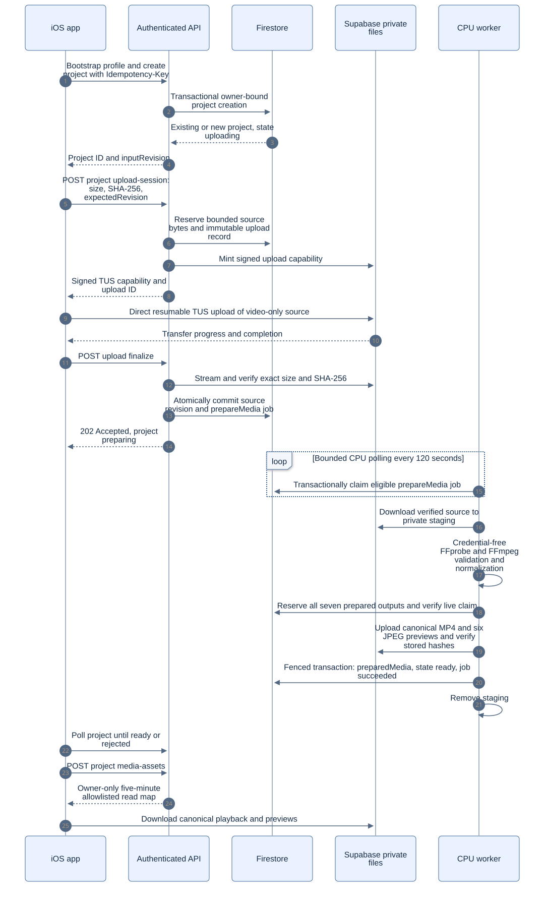

Upload creation reserves the maximum object allowance, then finalization verifies
actual size/hash and adjusts accounting. The logical upload session lasts 24 hours;
the provider's signed upload capability lasts two hours and can be refreshed by
the owner while the logical session remains valid. Preparation is a durable job,
not decoding inside a request. Accepted clips are 1–60 seconds, at most 50 MiB,
with validated formats/dimensions/frame rates. Invalid inputs become rejected;
transient processing/storage failures retry within the job bound.

Sources: [upload routes](../api/assets.py), [upload transactions](../src/footylevels/uploads.py),
[CPU jobs](../src/footylevels/media_jobs.py), [media processor](../src/footylevels/media_preparation.py).

## 08 — Reconstruction and playback

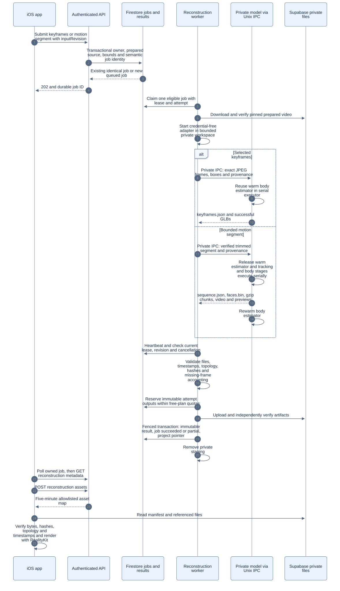

Keyframes select **1–24 distinct canonical frames** with normalized subject boxes.
Motion selects **30–300 frames**, start inclusive/end exclusive, from the canonical
30 fps prepared video. The server computes the request hash, pins the source and
uses idempotent enqueue. The sequence shows a successful path; failures, retries
and cancellation use view 09. Worker heartbeats run throughout the attempt, not
just at the illustrated checkpoint.

Motion tracking and body stages run sequentially; the warm body estimator is
released for these stages and restored afterward. Private cache replay never grants
publication rights. Results declare topology, source timestamps, missing frames,
engine fingerprints and estimated metric units. This body-only profile omits
optional ball/ground calibration and does not establish measured physical scale.
The iOS player checks file size/hash and bounded decoding before rendering; it
discards stale session responses and tears down private playback on logout.

Sources: [submission](../api/cloud.py), [worker publication](../src/footylevels/reconstruction_worker.py),
[adapter](../infra/dgx/reconstruction_adapter.py),
[model bridges](../runtime/skill_lab/backend/model_bridge.py),
[client](../../Frontend/FootyLevels-Frontend/Services/CloudReconstructionClient.swift),
[private playback](../../Frontend/FootyLevels-Frontend/Services/PrivatePlaybackAssets.swift).

## 09 — Durable job states


The same status vocabulary covers preparation and reconstruction. `partial` is a
reconstruction outcome; preparation publishes all validated required outputs or
fails. An expired running lease may be reclaimed directly as `running` with a new
attempt, while transient failures explicitly set `retrying`. Exact duplicate
requests return the same durable job, including terminal outcomes.

Reconstruction claims have a five-minute renewable lease, 30-second runner
heartbeats, a one-hour attempt deadline, a 24-hour total deadline and three attempts
by default; transient retry delays are two then four minutes. Media claims use a
15-minute lease and a hard ten-minute worker watchdog. Owner cancellation of media
preparation is handled by deleting its project. Publication atomically rechecks
source/revision, ownership, current attempt/lease/deadline and the project fence.

Sources: [reconstruction lifecycle](../src/footylevels/reconstruction_jobs.py),
[media lifecycle](../src/footylevels/media_jobs.py),
[enqueue/idempotency](../src/footylevels/repositories.py).

## 10 — Deletion and retention


Confirmation immediately hides data and prevents new reads/publication. Issued
capabilities still need their grace periods; a library removal can hold quota for
up to three days. Maintenance deletes only validated exact objects, checks absence,
and releases quota once. It preserves enough root metadata to reject replayed
creation. Inconsistent provenance/accounting stays pending for reconciliation.

Account application-data removal uses the same bounded project cleanup, removes
owned comparisons/nested metadata and retains an unavailable profile tombstone.
It does not remove the Firebase login identity or add an account-settings screen.
Active recordings have no automatic age-based deletion. Curated references and
other owners' assets remain outside the owned cleanup.

Sources: [deletion service](../src/footylevels/deletions.py),
[CPU reconciliation](../infra/dgx/run_media_worker.py),
[retention policy](../docs/deletion.md), [verified cleanup evidence](../infra/dgx/deletion-evidence.json).

## 11 — Recovery and operating limits


Process recovery and job recovery have separate responsibilities. Systemd reaps
the old cgroup and retries the service; durable Firestore leases/attempts prevent
late publication and bound retry work. GPU preflight never evicts another user's
process or implies capacity is reserved. Manual stop suppresses automatic restart.
The timer's bounded `health.json` reports local service state and warmup only;
public connectivity, executing-job progress, cloud access and storage growth need
separate operator checks. Raw application stdout/stderr is discarded by these units.

Recorded controlled recovery on 12 October: API crash **16.21 s**, model exit to
warm weights **85.84 s**, ngrok exit to agent running **30.32 s**, followed by public
health/auth-denial checks. These are component/service tests. A fresh reconstruction
or a full interactive iPhone session is not inferred from them.

Sources: [service definitions](../infra/dgx/services.py),
[operations](../infra/dgx/services.md),
[durable controls](../infra/dgx/reconstruction_control.py),
[recovery evidence](../infra/dgx/service-recovery-evidence.json).

## 12 — Lessons from your own video: system context


A signed-in learner taps **Create lesson** on a prepared video. The API admits a
`buildLesson` job; the existing GPU runner claims it, screens the clip with Gemini,
reconstructs whole-clip motion with ball tracking through the private runtime, writes
and checks the lesson, and publishes a private bundle. The app downloads the bundle
directly from Supabase with signed URLs and plays it in the existing lesson player.
Lessons are labelled AI-generated and never score the player.

Sources: [lesson API](../api/lessons.py), [lesson worker](../src/footylevels/lesson_worker.py),
[feature doc](../docs/lesson-from-video.md).

## 13 — Lesson components


No new service was added. Lesson jobs share the GPU runner and its serial lock; the
runner routes a claim by `kind`. The worker parent imports `lesson_pipeline` and holds
the Gemini key; the GPU step runs in a credential-free child. The app reuses
`PackageLessonView` unchanged: a downloaded lesson is an ordinary `Lesson-<id>.bundle`.

Sources: [runner](../infra/dgx/run_reconstruction_worker.py), [adapter](../infra/dgx/lesson_adapter.py),
[grounded authoring](../lesson_pipeline/grounded.py), [app contract](../lesson_pipeline/app_contract.py),
[motion bridge](../runtime/skill_lab/backend/motion_bridge.py).

## 14 — Updated data model for lessons


Same conventions as view 04. New optional fields (`lessonAiConsentAt`,
`latestLessonId`, `lessonId`) are written only once set, so older strict readers keep
working during a rolling upgrade. A lesson's id equals its job id; one report is kept
per lesson and reason; `lessonQuota` holds one counter per user per UTC day. Project
and account deletion remove lessons, reports and quota counters.

Sources: [records](../src/footylevels/records.py), [lesson repository](../src/footylevels/lessons.py),
[lesson jobs](../src/footylevels/lesson_jobs.py), [deletions](../src/footylevels/deletions.py).

## 15 — Create-lesson sequence

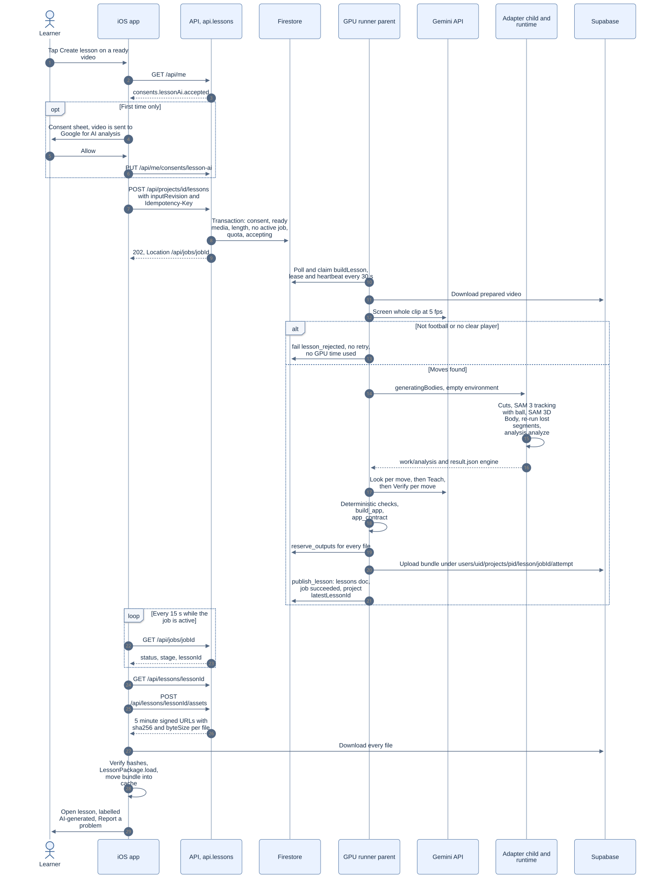

Consent is asked once per account and checked again inside the enqueue transaction,
together with ready media, clip length (`LESSON_MAX_SECONDS`, default 20), no active
job, the daily quota (`LESSON_DAILY_LIMIT`, default 3) and the runtime switch. The
Development run took about 16 minutes for a 9.3 s clip (GPU about 5, authoring about 9).

Sources: [lesson API](../api/lessons.py), [app client](../../Frontend/FootyLevels-Frontend/Services/CloudLessonClient.swift),
[view model](../../Frontend/FootyLevels-Frontend/ViewModels/CloudLessonViewModel.swift).

## 16 — Grounded multi-pass authoring


Each Gemini pass has a narrow job and a checker that drives bounded repair. The 3D
measurements act as a second witness: the ball foot follows measured contacts, keys
snap to measured events, and every number in the text is a placeholder filled from
`analysis.json` at build time. Accepted answers are cached per job, so a retried
attempt does not pay again. The single-call baseline remains as `generate --mode baseline`.

Sources: [passes](../lesson_pipeline/passes.py), [clips](../lesson_pipeline/clips.py),
[session](../lesson_pipeline/generation.py), [plan](../docs/lesson-pipeline-plan.md).

## 17 — buildLesson job lifecycle


The job reuses the reconstruction lease rules (view 09): one-hour attempts, three
attempts, 24-hour total deadline, fenced publication. `lesson_rejected` is final and
spends no GPU time. Lesson jobs stay queued unless the runner has both the lesson
adapter and a Gemini key.

Sources: [lesson jobs](../src/footylevels/lesson_jobs.py), [lesson worker](../src/footylevels/lesson_worker.py).

## 18 — Lesson package schema


The structure the app decodes in `LessonPackage.swift`. `app_contract.py` mirrors its
checks in Python and runs before publication, so a bundle that would fail on the phone
is never published. Full field notes are in [SPEC.md](../lesson_pipeline/SPEC.md) and the
[JSON schema](../lesson_pipeline/schema/lesson.schema.json).

## 19 — Credentials, isolation and storage


Only the worker parent holds cloud credentials and the Gemini key. The adapter child
gets `job.json` without the lease token and runs with an empty environment; the runtime
accepts only its own staging file name. Files are budgeted with `reserve_outputs`
before upload, and the app checks every download against the recorded SHA-256 and size
before the bundle is moved into its cache.

## 20 — App states for Create lesson


`CloudLessonViewModel` polls every 15 s while the job is active and maps each stage to
a status line. A failed or rejected job shows a plain message and allows another try.

Sources: [view model](../../Frontend/FootyLevels-Frontend/ViewModels/CloudLessonViewModel.swift),
[lesson store](../../Frontend/FootyLevels-Frontend/Services/UserLessonStore.swift).

## Pending implementation and acceptance

| Area | Boundary shown by these diagrams |
| --- | --- |
| Demo runtime | Cloud foundations exist; no active Demo API/public origin or second GPU dispatcher is claimed |
| Physical iPhone and Google sign-in | Simulator/private and public component proofs exist; full physical-device and interactive Google-login acceptance remain open |
| Comparison/history polish | Core result/reference/comparison schemas are present; full comparison write flow, overlay/side-by-side and factual history use cases remain separate tickets |
| Account lifecycle | Application-data cleanup exists; provider identity deletion/account-settings UI remain separate |
| FP-55 operations | Service recovery is verified; release CI, rollback rehearsal, export/restore with deletion replay and expanded queue/storage monitoring remain |
| Lessons from video | Development run verified server-side; app HTTP flow with a real sign-in, live 403/409/429 refusals, 20 s clip budgets and the new iOS tests have not run |
| Backups and reboot | No application backup/restore exercise or shared-host reboot is claimed; future restores must preserve/apply tombstones before access or dispatch |

## Edit and regenerate

Edit the `.mmd` sources, then use the pinned local
[Mermaid CLI](https://github.com/mermaid-js/mermaid-cli) renderer. The toolchain is
documentation-only; it is not an application/DGX dependency.

```sh
cd diagrams
npm ci
npm run render
```

For an existing Chrome installation, skip the Puppeteer browser download and set
its executable path for rendering. On this Mac:

```sh
npm ci --ignore-scripts
PUPPETEER_EXECUTABLE_PATH="/Applications/Google Chrome.app/Contents/MacOS/Google Chrome" npm run render
```

The renderer validates every diagram and updates previews only after all SVG/PNG
exports succeed. Styling lives in `theme.json`; `node_modules` and local browser
configuration are ignored. Rendering reads only the checked-in diagram text and
does not contact the FootyLevels API, databases or user media. After any architecture
change, update the relevant source, captions/status, and both preview formats
together. Check route/schema labels against source and review rendered layout.
