# 01 Overview

## In short

FootyLevels helps football players learn skills from video. A player records or imports a short
clip on an iPhone. The app uploads it privately; a server on the team's DGX machine turns it into a
3D model of the player's body moving in sync with the video. Players can study bundled lessons,
create an AI-written lesson from their own clip, compare two movements, and share clips with a
private circle of friends or a coach for feedback. Nothing in the app scores or ranks a player.

## Features

| Feature | What the player does | Main parts |
| --- | --- | --- |
| Accounts | Sign in with email or Google | Firebase Auth, API profile |
| Videos | Record or import a clip, trim it, upload it | iOS uploader, Supabase, CPU worker |
| 3D motion | Turn key poses or a 1–10 s segment into 3D | GPU runner, model runtime |
| Learn | Work through bundled lessons in four stages | iOS lesson player |
| Lessons from your video | Get a private AI lesson from a ready clip | Lesson API, GPU runner, Gemini |
| Community | Share clips with a private circle; get feedback at a video moment | Circle API |
| Overlay | Compare two motions overlaid or side by side | iOS comparison (legacy server in Debug) |
| Deletion | Delete a video or all account data | API tombstones, CPU worker cleanup |

## System context

The app sends small JSON requests to the API through an ngrok HTTPS endpoint. Video and 3D files
never pass through the API: the API hands out short-lived upload and read capabilities and the app
talks to Supabase storage directly. Firestore holds all records and doubles as the job queue.

## Deployment

One DGX runs everything the team owns, under `systemd --user` services: the API on loopback
port 8010 behind ngrok, its two child workers (CPU and GPU), and a separate model runtime on
loopback 8013 that is only reachable through a Unix socket. Development and Demo use separate
Firebase projects and Supabase buckets; Demo has its foundation configured but no runtime yet.

| Component | Where it runs | Responsibility |
| --- | --- | --- |
| iOS app | iPhone (iOS 18+), SwiftUI and RealityKit | All user interaction, uploads, playback, lessons |
| API | DGX, `127.0.0.1:8010` behind ngrok | Identity checks, owned records, job admission, file capabilities |
| CPU worker | DGX, child of the API | Video preparation; deletion and retention cleanup |
| GPU runner | DGX, child of the API | 3D reconstruction and lesson jobs, one at a time |
| Adapters | DGX, short-lived children | FFmpeg and model requests with no credentials |
| Model runtime | DGX, `127.0.0.1:8013` and `inference.sock` | SAM 3 tracking and SAM 3D Body on one A100 |
| Firestore | Firebase (Dev, Demo) | Records and job queue; no direct client access |
| Supabase | `private-media` and `reference-assets` buckets | All user files; signed access only |
| Gemini | Google API, `gemini-4-carbon` | Lesson authoring, only after user consent |

## Backend components

One FastAPI codebase. Routers per feature (`api/cloud.py`, `api/assets.py`, `api/circles.py`,
`api/lessons.py`) share the Firebase verifier and domain repositories. Background work uses
Firestore job documents with leases, so a crashed worker's job is safely resumed. Model work runs
in credential-free child processes.

## iOS app

Four tabs (Learn, Overlay, Community, Videos), each owning `@Observable` view models. Service
clients share `AuthenticatedAPIClient` (Bearer token, one refresh on 401, no redirects, only
`/api/` paths on the configured origin) and `PrivatePlaybackAssets` (downloads checked against the
SHA-256 and size the API recorded). `SkillLabClient` is a legacy, unauthenticated server used only
in Debug builds by the Overlay tab.

## API map

Every route except `GET /api/health` needs a Firebase ID token. Ownership always comes from the
verified token, never from the request body. A resource that belongs to someone else returns the
same 404 as one that does not exist.

| Status | Meaning for the app |
| --- | --- |
| 401 | Sign in again |
| 403 | Account restricted, or a required consent is missing (`consent_required`) |
| 404 | Not found or not yours |
| 409 | Stale state: refresh and retry |
| 422 | Invalid input (for example a clip that is too long) |
| 429 | A limit was reached (storage budget, daily lesson limit) |
| 503 | A dependency is unavailable: retry later |

## Security model

- The app is untrusted. It holds a Firebase session and short-lived capabilities only.
- Firestore client rules deny everything; only the server reads and writes records.
- Upload capabilities last 2 hours, owner file reads 5 minutes, circle member reads 60 seconds.
- Only the GPU runner parent holds the Gemini key. Adapters run with an empty environment, and
  the model runtime has no cloud keys at all.
- Uploads and outputs are budgeted before they are written: 50 MiB per file, 200 MiB per user,
  800 MiB in total on the free storage plan.

## Storage

Details of every file path and record are in [02 Data model and schema](02-data-model.md).
