# 02 Data model and schema

## In short

FootyLevels stores two kinds of data. **Records** (accounts, videos, jobs, results, lessons, circles)
live in Google Firestore as JSON documents. **Files** (videos, previews, 3D motion, lesson bundles)
live in private Supabase storage. A record never contains a file or a link to one; it contains an
`AssetRef` that names the file and its checksum, and the API turns that into a short-lived signed
link only for someone allowed to see it.

All records are validated by Pydantic models in `src/footylevels/records.py`,
`src/footylevels/circles.py` and `src/footylevels/lessons.py` before they are written. Unknown
fields are rejected. Firestore does not enforce references; the services check them.

## All collections

| Collection | One document per | Written by | Feature |
| --- | --- | --- | --- |
| `users` | Firebase account | API | Accounts |
| `projects` | Uploaded video | API, CPU worker | Videos |
| `uploads` | Upload attempt | API | Videos |
| `jobs` | Background request | API, workers | Videos, 3D, Lessons |
| `reconstructions` | 3D result | GPU runner | 3D motion |
| `lessons` | AI lesson | GPU runner | Lessons from your video |
| `lessonReports` | Lesson and reason reported | API | Lessons from your video |
| `lessonQuota` | User and UTC day | API | Lessons from your video |
| `assetReservations` | Generated file | Workers | Storage budget |
| `storageUsage` | User, plus one global ledger | API, workers | Storage budget |
| `deletions` | Deletion request | API, CPU worker | Deletion |
| `references` | Curated reference clip | Curator (trusted) | Overlay |
| `comparisons` | Saved comparison | Server | Overlay (read-only API) |
| `circles` | Training circle | API | Community |
| `circleMemberships` | User (list of their circles) | API | Community |
| `circleInvites` | Current invite code (hashed) | API | Community |
| `circlePosts` | Shared clip | API | Community |
| `circleComments` | Feedback comment | API | Community |
| `circleCleanup` | Deleted circle awaiting cleanup | API, CPU worker | Community |
| `runtimeControls` | Switch (`reconstruction`) | Operator | Operations |

## Common fields and types

Every record has `id`, `schemaVersion` (1), `createdAt` and `updatedAt` (UTC timestamps).
IDs match `^[a-zA-Z0-9_-]{1,128}$`.

**AssetRef**, used wherever a record points at a file:

| Field | Type | Rule |
| --- | --- | --- |
| `bucket` | string | `private-media` or `reference-assets` |
| `objectKey` | string | Path inside the bucket; never a URL; no `..`, `?`, `#`, `:` or `%` |
| `sha256` | string | 64 hex characters; every download is checked against it |
| `byteSize` | integer | 1 byte to 50 MiB |
| `contentType` | string | For example `video/mp4`, `application/json`, `image/jpeg` |

New optional fields (such as `lessonAiConsentAt` or `latestLessonId`) are written only once they
hold a value, so older strict readers keep working during a rolling upgrade.

## Accounts, videos and 3D

### users

| Field | Type | Meaning |
| --- | --- | --- |
| `id` | string | Firebase UID |
| `displayName` | string, 1–80 | From the token, or "Player" |
| `accountState` | enum | `active`, `restricted`, `deleting`, `deleted` |
| `lessonAiConsentAt` | timestamp, optional | When the player allowed AI lessons |
| `lessonAiConsentVersion` | enum, optional | `lesson-ai-v1` |

### projects

| Field | Type | Meaning |
| --- | --- | --- |
| `ownerId` | UID | Owner; only they can see it |
| `title`, `label` | string | Shown in the library |
| `source` | enum | `capture` or `gallery` |
| `state` | enum | `uploading`, `preparing`, `ready`, `rejected`, `deleting`, `deleted` |
| `inputRevision` | integer ≥ 1 | Increases with every new source video; jobs pin it |
| `video` | AssetRef | The verified original upload |
| `preparedMedia` | object | `video` AssetRef, `width` ≤ 1280, `height` ≤ 720, `fps` 30, `duration` 1–60.05 s, `frameCount` 30–1802, `sourceRotation`, 6 `previews` |
| `mediaError` | enum, optional | `invalid_media`, `unsupported_media`, `source_file_limit`, `prepared_file_limit`, `processing_limit`, `preparation_unavailable` |
| `activeJobId`, `activeUploadId` | ID, optional | At most one active job and upload per video |
| `latestReconstructionId`, `latestLessonId` | ID, optional | Newest results |
| `deletedAt` | timestamp, optional | Set when tombstoned |

### uploads

| Field | Type | Meaning |
| --- | --- | --- |
| `ownerId`, `projectId` | IDs | Owner and video |
| `expectedRevision` | integer | Revision the upload will replace |
| `asset` | AssetRef | Expected path, size, SHA-256 and type |
| `status` | enum | `uploading`, `committed`, `cancelled` |
| `reservedBytes` | integer | Budget held, up to 50 MiB |
| `expiresAt`, `cleanupAfter` | timestamps | Capability expiry and earliest cleanup |
| `committedRevision` | integer, optional | Revision created on finalize |

### jobs

| Field | Type | Meaning |
| --- | --- | --- |
| `id` | string | Hash of the request, so a repeat finds the same job |
| `ownerId`, `projectId` | IDs | Owner and video |
| `kind` | enum | `prepareMedia`, `reconstructKeyframes`, `reconstructMotion`, `buildLesson` |
| `status` | enum | `queued`, `running`, `retrying`, `succeeded`, `partial`, `failed`, `cancelled` |
| `stage` | string | Current step, shown in the app |
| `inputRevision`, `inputHash`, `profileVersion`, `sourceAsset` | | What exactly is being processed |
| `keyframes` | list, optional | 1–24 frames, each `frameIndex` and normalized `bbox` |
| `motionSegment` | object, optional | `startFrame`, `endFrame`; 30–300 frames |
| `attemptCount`, `maxAttempts` | integers | Default 3 attempts |
| `leaseToken`, `leaseExpiresAt`, `workerId`, `heartbeatAt` | server only | Never returned to the app |
| `attemptDeadlineAt`, `deadlineAt`, `nextAttemptAt` | timestamps | 1 h per attempt, 24 h total |
| `errorCode` | enum, optional | `invalid_media`, `unsupported_media`, `source_file_limit`, `prepared_file_limit`, `processing_limit`, `preparation_unavailable`, `model_unavailable`, `reconstruction_failed`, `job_deadline`, `input_changed`, `lesson_unavailable`, `lesson_rejected` |
| `reconstructionId`, `lessonId` | ID, optional | Published result |

### reconstructions

| Field | Type | Meaning |
| --- | --- | --- |
| `id`, `jobId` | ID | Same value |
| `ownerId`, `projectId`, `inputRevision`, `sourceAsset` | | Provenance |
| `profileVersion` | string | `body-keyframes-v1` or `body-motion-30fps-v1` |
| `mode` | enum | `keyframes` or `motion` |
| `outcome` | enum | `ready` or `partial` (some frames missing) |
| `engine` | object | `modelName`, `upstreamCommit`, `checkpointHash`, `configHash` |
| `contract` | object | `schemaVersion`, `topologyVersion`, `rightHandedYUp`, `meters`, encoding `glb` or `motionBuffers` |
| `artifacts` | AssetRef list | Up to 32 files |
| `requestedFrameCount`, `reconstructedFrameCount`, `missingFrameCount` | integers | Must add up; missing > 0 means `partial` |

### Budgets and deletion

| Collection | Fields | Meaning |
| --- | --- | --- |
| `assetReservations` | `jobId`, `ownerId`, `asset`, `bytes` | A generated file counted against the budget before it is written |
| `storageUsage` | `bytes` | `global` (800 MiB cap) and one per hashed UID (200 MiB cap) |
| `deletions` | `ownerId`, `scope` (`project`/`account`), `projectId`, `state` (`pending`/`completed`), `notBefore`, `completedAt`, `lastError` (`cleanup_unavailable`/`reconciliation_required`) | Durable deletion request |
| `runtimeControls/reconstruction` | `acceptingRequests` | Operator switch; `false` pauses new 3D and lesson requests |

## Lessons from your own video

### lessons

| Field | Type | Meaning |
| --- | --- | --- |
| `id`, `jobId` | ID | Same value as the `buildLesson` job |
| `ownerId`, `projectId`, `inputRevision`, `sourceAsset` | | Provenance |
| `profileVersion` | enum | `lesson-3d-v1` |
| `title` | string, 1–120 | From the lesson |
| `skills` | list, 1–8 | `id` slug and `name` of each move |
| `authoring` | object | `model`, `mode` (`grounded`/`baseline`), `promptSha256`, `claimsRemoved`, `calls` |
| `engine` | object | 3D model provenance |
| `artifacts` | AssetRef list, 4–64 | Must include `lesson.json`, `analysis.json`, `mesh.json`, `video.mp4`, all under `users/{uid}/projects/{pid}/lesson/{jobId}/` |
| `aiGenerated` | `true` | Always true |
| `state` | enum | `ready` or `deleted` |
| `completedAt` | timestamp | |

### lessonReports and lessonQuota

| Collection | Fields | Rule |
| --- | --- | --- |
| `lessonReports` | `ownerId`, `lessonId`, `projectId`, `reason` (`wrong_move`, `wrong_timing`, `unsafe`, `inaccurate`, `other`), `note` ≤ 500 | ID is a hash of user, lesson and reason: one report per reason |
| `lessonQuota` | `ownerId`, `day` (YYYYMMDD), `count`, `expiresAt` | ID `uid-YYYYMMDD`; default limit 3 per day |

## Community circles

| Collection | Key fields | Rules |
| --- | --- | --- |
| `circles` | `ownerId`, `name` ≤ 80, `description` ≤ 240, `state` (`active`/`deleted`), `memberIds`, `members` (`uid`, `displayName`, `joinedAt`, `generation`), `inviteHash`, `postCount` | Max 20 members and 200 posts per circle |
| `circleMemberships` | `circleIds` | Max 20 circles per player |
| `circleInvites` | `circleId`, `expiresAt` | ID is the SHA-256 of a 43-character code; 7 days; rotating deletes the old code |
| `circlePosts` | `circleId`, `authorId`, `authorName`, `projectId`, `projectTitle`, `skill` ≤ 60, `note` ≤ 500, `previousPostId`, `video` (duration, width, height, fps, frameCount, asset), `motion` (pinned reconstruction and job snapshot), `inputRevision`, member generation, `state`, `commentCount` | Max 200 comments per post; hidden if any pinned fact changes |
| `circleComments` | `postId`, `authorId`, `authorName`, `text` 1–500, `timestamp` (seconds into the video, optional), `state` | Newest first |
| `circleCleanup` | `circleId`, `ownerId` | Marks a deleted circle whose posts the worker still has to remove |

## Overlay references and comparisons

| Collection | Key fields |
| --- | --- |
| `references` | `title`, `version`, `videoAsset` and optional `manifestAsset` (in `reference-assets`), `licenseReference`, `publicationState` (`draft`, `published`, `retired`) |
| `comparisons` | `ownerId`, `leftReconstructionId`, `rightType` (`reconstruction`/`reference`), `rightId`, `rightReferenceVersion`, `mode` (`overlay`/`sideBySide`), `offsetMs` (±600 000), `state` (`ready`/`invalidated`) |

## File layout

All user files are under `private-media/users/{uid}/projects/{pid}/`:

| Path | Contents |
| --- | --- |
| `source/{uploadId}/video` | Original upload |
| `media/{jobId}/{attempt}/` | `video.mp4` (prepared) and 6 JPEG previews |
| `reconstruction/{jobId}/{attempt}/` | Key poses: `keyframes.json`, one GLB per pose. Motion: `sequence.json`, `faces.bin`, `body-NNNNNN.bin.gz` chunks, `preview-NNNN.jpg`, trimmed `video.mp4` |
| `lesson/{jobId}/{attempt}/` | `lesson.json`, `analysis.json`, `mesh.json`, `video.mp4`, `motion/sequence.json`, `motion/faces.bin`, `motion/body-NNNNNN.bin.gz` |

Each attempt writes to its own folder, so a retried job never overwrites a published file.

## Lesson file format

A lesson is a folder (`Lesson-<id>.bundle`) that the app reads with `LessonPackage.load`. The
machine-readable contract is
[`lesson_pipeline/schema/lesson.schema.json`](../../lesson_pipeline/schema/lesson.schema.json);
field notes are in [`lesson_pipeline/SPEC.md`](../../lesson_pipeline/SPEC.md).

| Part | Rules the app enforces |
| --- | --- |
| `lesson.json` | `schemaVersion` 1; at least one skill; times in seconds on the video clock |
| Skill | `range` inside the clip; at least 2 phases; 4–5 drills; 3–4 challenges |
| Phase | In order, inside the skill; `key` (freeze frame) inside the phase |
| Drill | `model` clip `[start, end, rate]` inside the skill; rate 0.25, 0.5 or 1; 3 self-checks |
| Challenge | `choice` (answer index valid), `tap` (target ± tolerance), `order` (only real phase ids) |
| `analysis.json` | One value per frame for every series (`com`, `comDropCm`, `weight`, feet, `planted`, `yaw`, `ball`, `ballSpeed`, `valid`, `ballAir`, `legSwap`); shots inside the clip |
| `mesh.json` | `vertexCount` and left/right foot vertex sets inside the mesh |
| `motion/` | Frame count equal to `analysis.json` |

`lesson_pipeline/app_contract.py` mirrors these checks in Python and runs before any lesson is
published, so a bundle the phone would reject never reaches it.

## App-side storage

| Where | What |
| --- | --- |
| App bundle | Shipped `Lesson-*.bundle` folders and the example clip |
| Application Support/PrivateUploads | Upload drafts; the resume URL is kept in the Keychain |
| Caches/UserLessons/{uid} | Downloaded lessons, excluded from backup; other accounts' folders are removed |
| UserDefaults | Drill progress (`lesson.<docId>.<skillId>.drills`) and the legacy server address |
