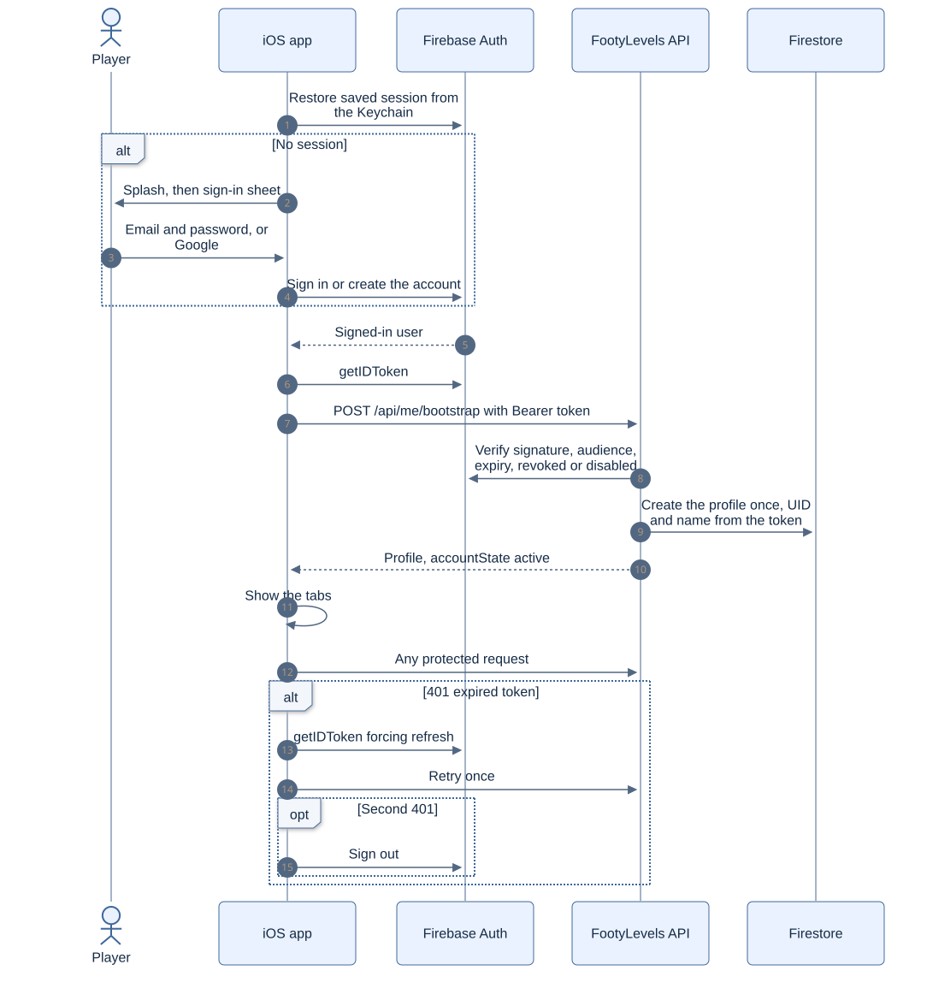

# 03 Accounts and sign-in

## In short

Players sign in with email and password or with Google, through Firebase Authentication. The
first time they connect, the FootyLevels API creates a profile for them. After that, every request
the app makes carries a short-lived Firebase token, and the API uses it to decide whose data the
request may touch.

## How it works

1. On launch the app waits for Firebase to restore a saved session from the Keychain, showing a
   splash. With no session it shows the sign-in sheet.
2. After sign-in the app calls `POST /api/me/bootstrap`. The API verifies the token (signature,
   project, expiry, revoked or disabled account) and creates the profile once, taking the UID and
   name from the token.
3. Every protected call sends `Authorization: Bearer <token>`. On a 401 the app refreshes the
   token and retries once; a second 401 signs the player out.
4. Responses that arrive after the player switched accounts are discarded (`AccountSession` keeps
   the UID and a generation counter).

## States

| Server state | Effect |
| --- | --- |
| `active` | Normal use |
| `restricted` | 403 on routes that need an active profile |
| `deleting` | Account data deletion in progress; no new projects |
| `deleted` | Minimal tombstone; bootstrap is refused so the account cannot be reactivated |

## Rules

- The API never trusts an owner ID from the client.
- The Firebase emulator is refused by the deployable API; there is no identity bypass.
- Debug builds can open the app without signing in to show the bundled example, but that grants
  no access to private data. The `FootyLevels-Development` scheme forces sign-in.
- Development and Demo use separate Firebase projects; Release builds always use Demo.

## Code

Backend: `src/footylevels/authentication.py`, `api/cloud.py` (`identity`, `active_identity`,
bootstrap and profile routes), `docs/authentication.md`.
Frontend: `AuthManager.swift`, `FirebaseAPICredentials.swift`, `AuthenticatedAPIClient.swift`,
`AppStateViewModel.swift`, `CheckUser.swift`, `ApplicationEnvironment.swift`.
