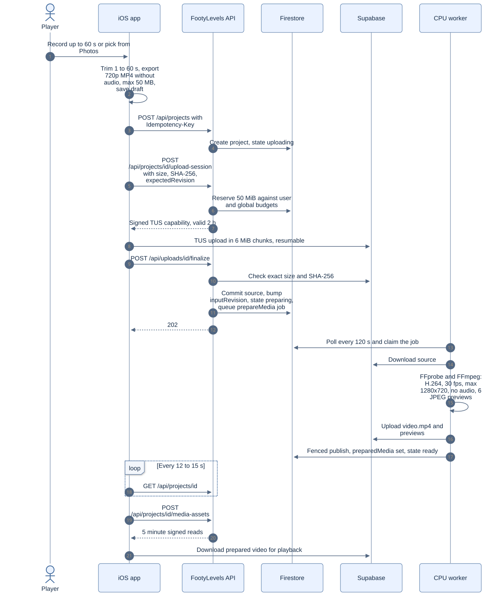

# 04 Videos: upload and preparation

## In short

A player records up to 60 seconds or picks a clip from Photos, trims it and names it. The phone
compresses it to a silent 720p MP4 and uploads it straight to private storage in resumable chunks,
so a dropped connection does not start over. The server then checks the file and makes a standard
copy (30 frames per second, at most 720p, no sound) with six preview images. Every later feature
uses that copy.

## How it works

1. **On the phone:** trim to 1–60 s, export 720p H.264 without audio, keep under 50 MB, save a
   draft in Application Support.
2. **Create the project:** `POST /api/projects` with an `Idempotency-Key`, so a retry never makes
   a second project.
3. **Upload session:** `POST /api/projects/{id}/upload-session` with size, SHA-256 and expected
   revision. The API reserves 50 MiB against the player's 200 MiB and the global 800 MiB budgets
   and returns a signed TUS capability valid for 2 hours.
4. **Transfer:** TUS upload in 6 MiB chunks directly to Supabase. The app pauses when it goes to
   the background and resumes later with a fresh capability (`POST /api/uploads/{id}/refresh`).
5. **Finalize:** `POST /api/uploads/{id}/finalize`. The API checks the exact size and SHA-256,
   bumps `inputRevision`, sets the project to `preparing` and queues a `prepareMedia` job.
6. **Preparation:** the CPU worker claims the job (it checks every 120 s), runs FFprobe and FFmpeg
   with no credentials, uploads `video.mp4` and six JPEG previews, and publishes `preparedMedia`.
   The project becomes `ready`.
7. The app polls the project every 12–15 s and then fetches 5 minute signed read links.

## Project states

| State | Shown as |
| --- | --- |
| `uploading` | Upload not finished |
| `preparing` | Uploaded, waiting for media preparation |
| `ready` | Video ready |
| `rejected` | Video needs attention (`mediaError` gives the reason) |

## Rules and limits

- Accepted input: 1–60 s, H.264, HEVC or MPEG-4 in an MP4 or QuickTime container.
- 50 MiB per file, 200 MiB per player, 800 MiB in total (free storage plan).
- A preparation failure caused by storage or tooling retries; bad media is rejected for good.

## Code

Backend: `api/assets.py`, `src/footylevels/uploads.py`, `media_preparation.py`, `media_jobs.py`,
`media_worker.py`, `infra/dgx/run_media_worker.py`, `docs/media-preparation.md`.
Frontend: `ClipImportEditor.swift`, `VideoRecordingPicker.swift`, `VideoClipPreparer.swift`,
`CloudUploadsViewModel.swift`, `CloudUploadCoordinator.swift`, `PrivateTUSClient.swift`,
`UploadDraftStore.swift`, `ProjectsListView.swift`.
