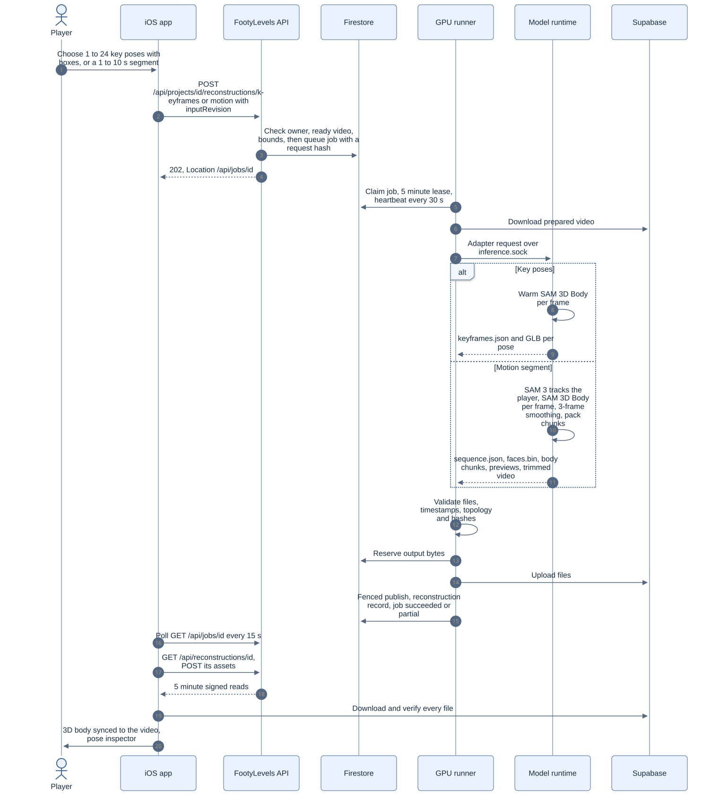

# 05 3D motion

## In short

From a prepared video, a player can ask for 3D in two ways: up to 24 chosen **key poses**, or a
**motion segment** of 1 to 10 seconds. The DGX's GPU builds a 3D body for each frame using Meta's
SAM 3 (to find and follow the player) and SAM 3D Body (to build the body). The app then plays the
3D body in sync with the video, which the player can rotate, slow down and inspect.

## How it works

1. The app sends `POST /api/projects/{id}/reconstructions/keyframes` (1–24 frames with a box
   around the player) or `.../motion` (30–300 frames), with the project's `inputRevision`.
2. The API checks ownership, a ready video and the bounds, then queues a job whose ID is a hash
   of the request, so asking twice returns the same job.
3. The GPU runner claims the job with a 5 minute lease and a heartbeat every 30 s, downloads the
   prepared video and starts a credential-free adapter.
4. The adapter talks to the model runtime over a private Unix socket and checks everything it
   gets back: file names, sizes, hashes, frame counts, timestamps and mesh topology.
5. The runner reserves output bytes, uploads the files and publishes a `reconstructions` record in
   a transaction that fails if the job was cancelled, the video replaced or the project deleted.
6. The app polls the job, fetches 5 minute signed reads and plays the result with RealityKit.

## Jobs

All background work (preparation, 3D, lessons) shares this lifecycle: one lease per attempt,
3 attempts, 1 hour per attempt, 24 hours in total, and cancellation or deletion stops late
publication. A result with some frames missing is `partial` and still playable.

## Model runtime

| Profile | Used by | Limits |
| --- | --- | --- |
| `body-keyframes-v1` | Key poses | 1–24 frames, warm SAM 3D Body |
| `body-motion-30fps-v1` | Motion segments | 30–300 frames, body only |
| `lesson-motion-v1` | Lessons from your video | Up to 600 frames, with ball tracking and `tracking.json` |

The runtime has one serial executor, so GPU work runs one job at a time. The subject is the
largest person at the start of each camera shot. Scale is estimated in metres from one camera and
is not calibrated.

## Code

Backend: `api/cloud.py` (reconstruction routes), `model_requests.py`, `reconstruction_jobs.py`,
`reconstruction_worker.py`, `infra/dgx/reconstruction_adapter.py`,
`infra/dgx/body_keyframes_adapter.py`, `runtime/skill_lab/backend/model_bridge.py`,
`motion_bridge.py`, `docs/reconstruction-api.md`, `docs/reconstruction-jobs.md`.
Frontend: `CloudReconstructionClient.swift`, `CloudProjectStatusView.swift`,
`PrivateKeyframePicker.swift`, `MotionPlayerViewModel.swift`, `PoseInspectorModel.swift`,
`PlaybackController.swift`, `PrivatePlaybackAssets.swift`.
