# 06 Learn: bundled lessons

## In short

The Learn tab teaches football skills with lessons that combine the original video and a 3D body
moving in sync. Every lesson has four stages: **Watch** the move, **Break it down** into phases,
**Practise** with drills, and **Test yourself** with short questions. Drill progress is saved on
the phone. The lessons shipped in the app are made by the team with the lesson pipeline and
reviewed by a person before release.

## The lesson player

- The Learn tab lists every `Lesson-*.bundle` in the app, the hand-built Over Fake lesson, and
  lessons built from the player's own videos ([07](07-lessons-from-your-video.md)).
- `LessonPackage.load` reads and checks the bundle before anything is shown, so a bad file shows
  an error instead of crashing.
- `PackageLessonModel` uses the video as the clock and draws the 3D body with the ball foot and
  standing foot coloured, plus optional footprints, trails, a ghost of the last step and arrows.
  The player can mirror the move to learn it on the other foot and change the camera angle.
- Readings during playback: weight shift, body drop, hip turn and ball speed, taken from
  `analysis.json`.
- Drill reps and self-checks are stored in UserDefaults and feed the profile card.

## Lesson format

Field rules are in [02 Data model and schema](02-data-model.md#lesson-file-format).

## How bundled lessons are made

1. `python -m lesson_pipeline run` reconstructs the whole clip on the GPU host over SSH, finds
   camera cuts, re-runs segments where tracking was lost and computes the measurements.
2. `generate` writes the lesson with Gemini (`--mode grounded` uses the measurements; see
   [07](07-lessons-from-your-video.md)).
3. `check` validates it; a person reviews it against the video following `PLAYBOOK.md`.
4. `build --app` and `integrate` copy the bundle into the Frontend for the next app build.

Five lessons ship today: skill ladder, hocus pocus, three 1v1 moves, three levels, chop and spin.

## Code

Frontend: `LessonLibraryView.swift`, `LessonLibrary.swift`, `LessonPackage.swift`,
`PackageLessonModel.swift`, `PackageLessonView.swift`, `PackageLessonSheet.swift`,
`PackageLessonSections.swift`, `SkillLesson.swift` (drill progress), `SampleData/Lessons/`.
Backend: `lesson_pipeline/` (`README.md`, `SPEC.md`, `PLAYBOOK.md`, `cli.py`, `build.py`).
