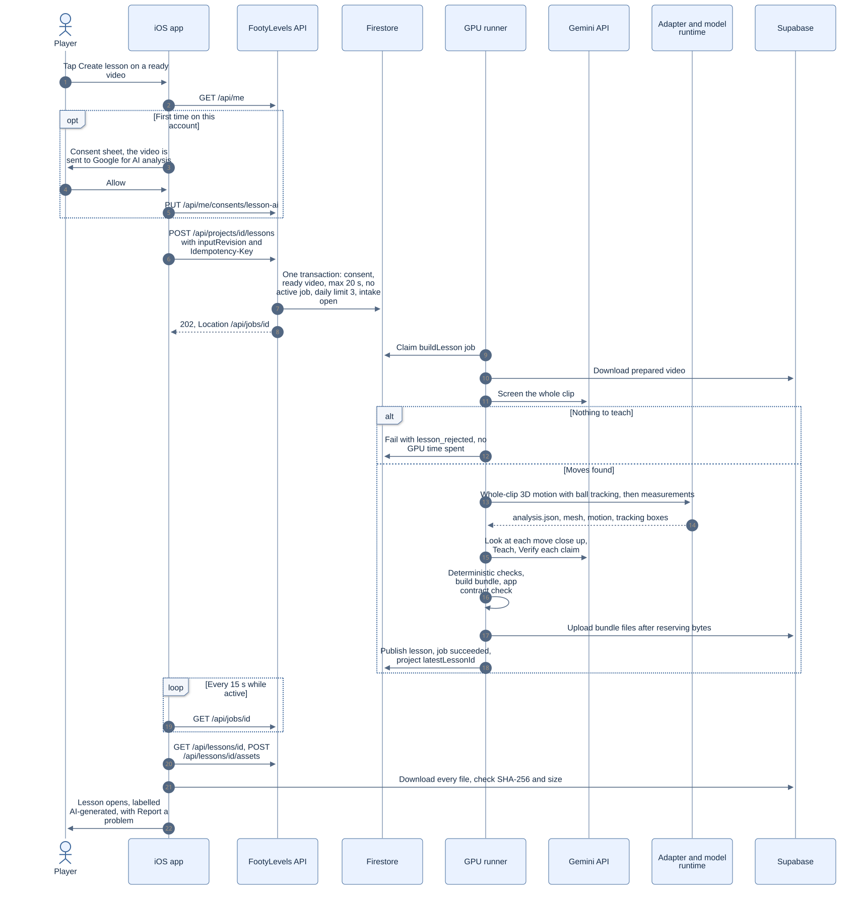

# 07 Lessons from your own video

## In short

A player taps **Create lesson** on one of their ready videos. The first time, the app asks
permission to send the video to Google's Gemini AI. The server then builds a 3D model of the clip,
has Gemini write a lesson in four careful passes that are checked against the 3D measurements,
and checks the result before publishing it. About 15 minutes later the lesson appears in the
Learn tab, private to the player, marked as AI-generated and with a "Report a problem" button. It
teaches the move; it does not grade the player.

## How it works

1. **Consent:** asked once per account (`PUT /api/me/consents/lesson-ai`, version
   `lesson-ai-v1`), and checked again on every request.
2. **Request:** `POST /api/projects/{id}/lessons` with `inputRevision` and an `Idempotency-Key`.
   One transaction checks consent, a ready video, length ≤ 20 s, no other active job, the daily
   limit (3) and the intake switch, then queues a `buildLesson` job.
3. **Build:** the GPU runner runs the stages below.
4. **Download:** the app polls the job every 15 s, then `GET /api/lessons/{id}` and
   `POST /api/lessons/{id}/assets` (5 minute links with SHA-256 and size for every file). It
   downloads into a staging folder, checks every file and `LessonPackage.load`, then moves the
   bundle into its cache. The existing lesson player opens it unchanged.

## Grounded authoring

| Step | Input | Output |
| --- | --- | --- |
| 1 Screen (Gemini) | Whole clip at 5 fps | Up to 4 moves with rough times, or a rejection before any GPU time |
| 2 Measure (GPU) | Prepared clip | `analysis.json`: touches, plants, turn, drop, ball; player boxes |
| 3 Look (Gemini, per move) | Player-cropped close-up at half speed, 10 fps, measured events as hints | Phases with start, end and freeze frame |
| 4 Teach (Gemini) | Checked timeline and the lesson schema | Cues, drills, questions; every number as a placeholder |
| 5 Verify (Gemini, per move) | Each claim and its close-up | Supported kept, unclear moved to "unsure", unsupported removed |
| 6 Checks (code) | Lesson and measurements | Ball foot from contacts, freeze frames snapped to events, questions topped up, placeholders filled, app contract |

A run makes about 3 + 2 × moves Gemini calls. Accepted answers are cached per job, so a retry
does not pay twice. The single-call version is kept as `generate --mode baseline` for comparison.

## Job stages

| Stage | Process | App shows |
| --- | --- | --- |
| `downloadingInput` | Runner | Starting your lesson |
| `screeningVideo` | Runner (holds the Gemini key) | Checking your video |
| `generatingBodies` | Adapter, empty environment | Building your 3D motion |
| `writingLesson` | Runner | Writing your lesson |
| `checkingLesson` | Runner | Checking your lesson |
| `publishingAssets` | Runner | Saving your lesson |

`lesson_rejected` (nothing to teach) is final. `lesson_unavailable`, `model_unavailable` and
`reconstruction_failed` retry.

## App states

## Records

## Limits and configuration

| Setting | Default |
| --- | --- |
| `GEMINI_MODEL` | `gemini-4-carbon` |
| `LESSON_MAX_SECONDS` | 20 |
| `LESSON_DAILY_LIMIT` | 3 per player per UTC day |
| `LESSON_MAX_FRAMES` (runtime) | 600 |

Lesson jobs stay queued unless the runner has the lesson adapter and a Gemini key.

## Status (13 November 2026)

Running in Development. A 9.3 s clip took about 16 minutes (GPU about 5, authoring about 9). Not
yet verified: the in-app flow with a real sign-in on a physical iPhone, the live 403/409/429
refusals, GPU budgets for 20 s clips, and the new iOS tests (they compile but have not run).

## Code

Backend: `api/lessons.py`, `src/footylevels/lessons.py`, `lesson_jobs.py`, `lesson_worker.py`,
`infra/dgx/lesson_adapter.py`, `lesson_pipeline/` (`grounded.py`, `passes.py`, `clips.py`,
`generation.py`, `app_contract.py`), `docs/lesson-from-video.md`, `docs/lesson-pipeline-plan.md`.
Frontend: `CloudLesson.swift`, `CloudLessonClient.swift`, `UserLessonStore.swift`,
`CloudLessonViewModel.swift`, `LessonConsentSheet.swift`, `UserLessonsSection.swift`,
`AILessonNotice.swift`.
