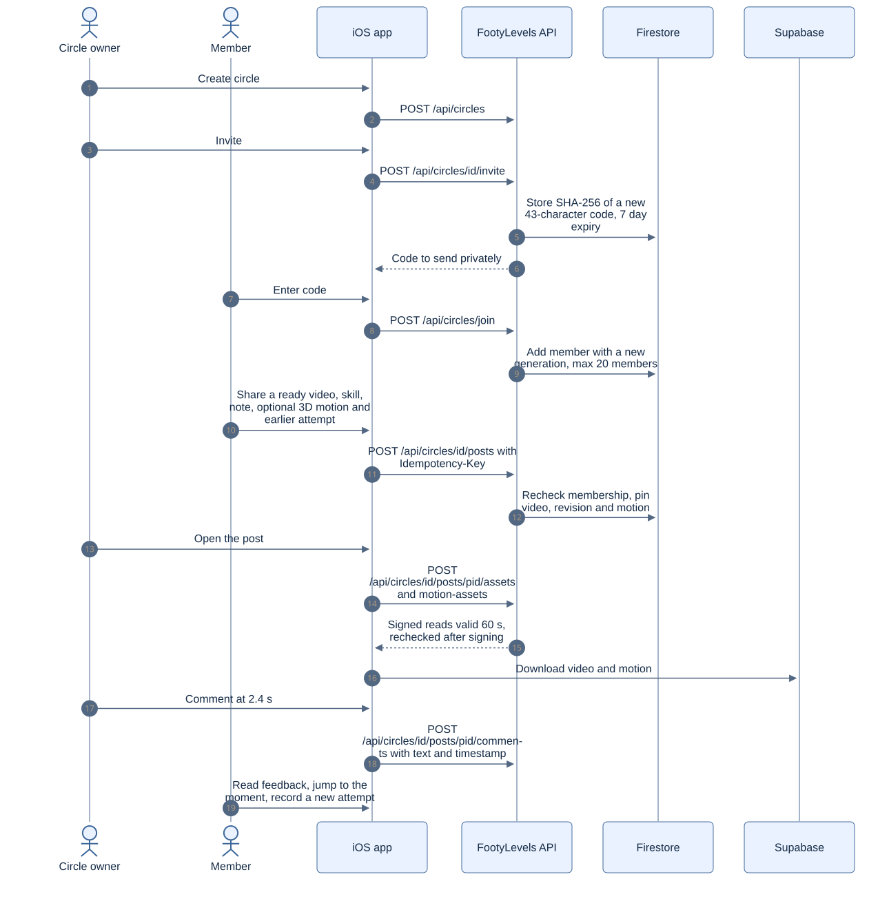

# 08 Community: training circles

## In short

Players can create a private circle with friends, teammates or a coach. The owner shares an invite
code; members join with it. A player chooses one of their ready videos to share, optionally with
its 3D motion, and members leave feedback pinned to a moment in the video. There is no public
feed, no direct messaging and no scoring. Leaving a circle, being removed, or deleting the video
hides the share straight away.

## How it works

1. `POST /api/circles` creates a circle; `POST /api/circles/{id}/invite` rotates the invite code
   (43 random characters, stored only as a SHA-256 hash, valid 7 days).
2. `POST /api/circles/join` with the code adds the member with a new membership generation.
3. `POST /api/circles/{id}/posts` shares a ready project with a skill, a note, an optional earlier
   attempt and an optional finished 3D motion. The server pins the video, revision and motion.
4. Members watch through `.../assets` and `.../motion-assets`, which sign only the pinned files
   for 60 seconds and recheck access after signing.
5. `POST .../comments` adds feedback with an optional timestamp in seconds.

## Access rules

Every request rereads the caller's membership, the owner's profile and the circle inside a
transaction. A post is shown only while its author is still a member with the same generation and
the pinned video and motion are unchanged. Rejoining does not bring back old posts.

## Records

## Limits

20 circles per player, 20 members per circle, 200 posts per circle and 200 comments per post
(lifetime). Text limits: name 80, description 240, skill 60, note and comment 500 characters.
Sharing and commenting need an `Idempotency-Key`.

## Code

Backend: `api/circles.py`, `src/footylevels/circles.py`, `docs/training-circles.md`.
Frontend: `CommunityView.swift`, `CircleDetailView.swift`, `CircleShareView.swift`,
`CirclePostView.swift`, `CommunityClient.swift`, `CommunityViewModels.swift`,
`TrainingCircle.swift`.
