# 09 Overlay comparison

## In short

The Overlay tab puts two movements side by side, A (you, in blue) and B (a reference, in orange),
either overlaid in one 3D scene or in two scenes next to each other. A's video is the clock and a
slider lines B up in time. It shows where two movements differ; it does not say which is better.

## How it works

- The player picks A and B from the bundled example or from projects on the legacy Skill Lab
  server. The same clip may fill both slots to compare two attempts within it.
- If a chosen project has no 3D motion yet, Debug builds can start one on the legacy server.
- `ComparisonModel` loads both motions once. Overlay mode moves B onto A's centre of mass;
  side-by-side mode uses two 3D stages.

## Current limits

- The tab still uses the unauthenticated legacy Skill Lab server, which is available only in
  Debug builds. Release builds offer the bundled example only.
- The cloud API stores `comparisons` and `references` records and exposes
  `GET /api/comparisons/{id}`, but creating comparisons through the API and choosing cloud
  projects in this tab are not built yet.
- On the iOS Simulator only the first 3D view draws, so check side-by-side on a device.

## Code

Frontend: `OverlayDifferenceView.swift`, `ComparisonView.swift`, `OverlayDifferenceViewModel.swift`,
`ComparisonModel.swift`, `SkillLabClient.swift`.
Backend: `ComparisonRecord` and `ReferenceRecord` in `src/footylevels/records.py`; `api/cloud.py`.
