# 10 Deletion and retention

## In short

When a player deletes a video, or all of their data, it disappears from the app at once and no
one can open it again. Removing the actual files from storage happens shortly afterwards, once any
links already handed out have expired, and every file is checked to be gone before the record is
closed. A small marker stays behind so that a delayed request cannot bring the data back.

## How it works

1. `DELETE /api/projects/{id}` or `DELETE /api/me/data` returns 202 with a deletion ID. The
   project (or profile) is tombstoned: hidden, jobs cancelled, no new links, no late publication.
2. The CPU worker processes up to 10 deletion intents every 120 seconds.
3. Each file is deleted only after its grace period: about 72 hours for an original upload,
   24 hours for generated files, and 5 minutes after the tombstone for read links.
4. After each delete the worker checks the file is absent, then releases its quota once.
5. When every recorded file is gone, it removes jobs, 3D results, lessons, lesson reports,
   comparisons, circle posts and comments, and marks the intent completed.
6. `GET /api/deletions` and `GET /api/deletions/{id}` report progress. A storage outage reports
   `cleanup_unavailable` and retries; an accounting mismatch stops at `reconciliation_required`.

## Rules

- Exact files only: no bucket or prefix wipe, no paths supplied by the client.
- Curated references and other players' data are never touched.
- Account deletion keeps the Firebase login and a minimal unavailable profile; removing the login
  itself is separate work.
- Links already issued cannot be revoked early; they expire on their own.

## Code

Backend: `src/footylevels/deletions.py`, `infra/dgx/run_media_worker.py` (reconciliation),
`docs/deletion.md`. Frontend: confirmation and progress in `ProjectsListView.swift`.
