# 11 Operations

## In short

Everything the team runs lives on one DGX under the team account, started by `systemd` user
services that restart automatically. If a process crashes, its work is not lost: jobs are stored
in Firestore with leases, so a restarted worker picks them up again. Deploys pause new requests,
switch to the new release and can switch back.

## Services and recovery

| Service | Restart | Notes |
| --- | --- | --- |
| API (`start_cloud_api.py`) | after 15 s | Starts and supervises the CPU worker and the GPU runner |
| Model runtime (`start_runtime.sh`) | retry after 60 s | Preflight: pinned weights, one A100, at least 12 GiB free |
| ngrok agent | after 30 s | Public HTTPS endpoint |
| Health timer | every minute | Writes `health.json` with local service state |

Recorded recovery (12 Oct 2026): API crash 16.21 s, model restart to warm weights 85.84 s, ngrok
30.32 s.

## Configuration

Private settings live in `~/.config/footylevels/<env>/runtime.json` on the DGX, never in git:
Firebase project, Supabase URL and secret, and optionally `GEMINI_API_KEY`, `GEMINI_MODEL`,
`LESSON_MAX_SECONDS`, `LESSON_DAILY_LIMIT`. Adapters and the model runtime receive none of them.

## Deploy and rollback

1. Set `runtimeControls/reconstruction.acceptingRequests` to `false` to pause new 3D and lesson
   requests.
2. Repoint `~/.local/share/footylevels/{cloud-api,runtime}/current` to the new release and
   restart the unit.
3. Smoke test public health and an authenticated request.
4. Roll back by repointing to the previous release.

## Known gaps

No CI, no linter and no external monitoring yet; service output is discarded by the units; no
backup and restore exercise has been run. These are tracked on FP-55.

## Code

`infra/dgx/services.py`, `infra/dgx/services.md`, `infra/dgx/start_cloud_api.py`,
`infra/dgx/start_runtime.sh`, `infra/dgx/cloud_config.py`, `infra/dgx/public-api.md`.
